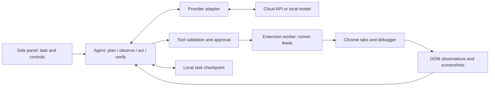

# Orbit

A working, model-agnostic Chrome browser-agent MVP. Connect a cloud API or a local model, give it a task, and watch it plan, inspect pages, take actions, and verify the result in a side panel.

This is an independent implementation of the browser-agent workflow. It does not use Anthropic's proprietary extension code or require a Claude subscription.

## Install in Chrome

1. Open `chrome://extensions`.
2. Turn on **Developer mode**.
3. Choose **Load unpacked** and select this project's **`extension`** folder.
4. Pin **Orbit**, open a normal website, and click the extension icon.
5. Open settings, choose a provider, enter your model ID and API key if needed, and click **Test connection**. Save settings, then enter a task.

Chrome 120 or later is required. There is **no install or build step** for the extension. Do not select the repository root when loading it.

To use the packaged version, extract `artifacts/orbit-extension.zip` and load the extracted folder containing `manifest.json`. The ZIP is a developer distribution, not a signed Chrome Web Store release.

## Bring your own model

| Provider preset | API base URL | Key |
| --- | --- | --- |
| OpenAI | `https://api.openai.com/v1` | API key |
| Anthropic | `https://api.anthropic.com/v1` | API key |
| Google Gemini | `https://generativelanguage.googleapis.com/v1beta` | API key |
| OpenRouter | `https://openrouter.ai/api/v1` | API key |
| NVIDIA API catalog | `https://integrate.api.nvidia.com/v1` | API key (`nvapi-…`) |
| Ollama | `http://localhost:11434/v1` | Usually empty |
| LM Studio | `http://localhost:1234/v1` | Depends on server configuration |
| Custom | Your OpenAI-compatible API root | Depends on server |

Enter an exact model ID that your account or server provides. Orbit deliberately does not hardcode a model catalog. An API key is separate from a consumer chat subscription.

**Native tools** uses the provider's function-calling API. **JSON instructions** is a fallback for text models without native tools. Orbit accepts the JSON even when it is wrapped in prose or uses common alternative key names. Enable **screenshots** only if the model supports image inputs. A connection test verifies text generation, not tool/vision quality.

### Smaller models

Orbit is built to do as much of a task as the model can manage reliably, then stop and ask instead of guessing:

- **Optimize for smaller models** (on by default for the Ollama and LM Studio presets) switches to a short, literal prompt and a smaller tool set without screenshot, drag, hover, close-tab or planning tools.
- **Model context window** sets the budget. Orbit trims older history, keeps only the two newest page observations in full, and sizes page descriptions to fit. Pages are described as compact lines such as `[a1b2c-4] button "Save"`, not JSON.
- **Re-read the page after each action** shows the model the result of every click or navigation immediately, so it does not need to remember to look.
- Unusable replies (bad JSON, unknown tools, empty output) are shown back to the model with what went wrong, and it tries again. Common argument slips are repaired: `"7"` for `7`, `[id]` with brackets, `element_id`, `"Down"`. Tool calls that local models print as text are picked up.
- Orbit never treats a reply as success just because the model said so. A reply without a tool call gets one reminder. `finish` is refused once if the last action was not checked on the page.
- Orbit **stops and asks you** when it is stuck: three unusable replies in a row, three failed steps in a row, or the same step repeated with no change to the page. It also stops when the model calls `ask_user`, which it is told to do for missing information, logins, CAPTCHAs, verification codes, and payments. Pages with password fields or CAPTCHAs carry an explicit hint to hand over to you. Reply to continue, or do the step yourself and reply "done".

For Ollama, set the server's context length to match the setting, for example `OLLAMA_CONTEXT_LENGTH=8192`. Ollama's OpenAI-compatible API silently drops the start of a conversation that exceeds the server's context, including Orbit's instructions. That is the most common cause of a local model "forgetting" how to use tools.

For Ollama, pull and serve your chosen model. For LM Studio, load a model and start its OpenAI-compatible server. If the local server rejects the extension's origin, permit the specific `chrome-extension://<extension-id>` origin in the server configuration; the extension ID appears in Chrome's extensions page. See the [Ollama API compatibility documentation](https://docs.ollama.com/api/openai-compatibility) and [LM Studio API documentation](https://lmstudio.ai/docs/developer/openai-compat).

Custom remote endpoints must use HTTPS. Plain HTTP is accepted for `localhost`, `127.0.0.1`, and IPv6 loopback. The adapters target Chat Completions, Anthropic Messages, and Gemini generateContent. A model available only through a proprietary chat website needs a separate API adapter or gateway.

## Browser capabilities

- Read visible text, links, controls, field labels, and select options.
- Read the full text of long pages in 25,000-character chunks (`get_page_text` with `offset`), including open shadow roots and same-origin frames.
- Find controls anywhere on the page by their text (`find`), including off-screen ones, without blind scrolling.
- Capture viewport screenshots for vision models.
- Click by element ID or screenshot coordinates; type, press shortcuts, hover, scroll, select options, and drag.
- Accept or dismiss JavaScript `alert`/`confirm`/`prompt` dialogs (`handle_dialog`). An action that opens one returns right away with the dialog text instead of hanging.
- Open, switch, navigate, go back, and close tabs.
- Inspect open shadow roots and same-origin frames; interact with cross-origin frames through coordinates.
- Maintain a task plan and working notes, ask for missing information, recover from tool errors, and verify outcomes.
- Pause, resume, stop, and switch models while retaining findings.
- Show the run's token usage (input and output, summed across turns) next to the step count.
- Save a task as a **shortcut** to rerun it later from the home screen.
- Save the latest run locally and export a log with connection secrets and raw tool payloads omitted.
- Open the panel with **Alt+Shift+O** (change it at `chrome://extensions/shortcuts`).

The default **Ask before making changes** mode reviews page-changing actions. Each review offers **Allow once**, **Allow on _site_ for this task**, or **Deny**. Allowing a site auto-approves later actions whose target is on that exact hostname until the task ends. The worker re-checks the target's hostname right before dispatch, so if the page has moved to another site the action is refused and needs a fresh approval. Navigating to a different hostname always asks again. **Act automatically** executes all actions without individual prompts. Chrome's debugger banner is expected; cancelling it pauses the run.

Keep the panel open while the agent works. Closing it interrupts model requests. Reopening restores the checkpoint for explicit resume. A previously dispatched action may already have happened; Orbit records its result as unknown and instructs the model to inspect the page rather than replay it. Resuming grants another configured block of model steps. A model change discards queued decisions and passes previous findings to the replacement model.

## Try a local practice task

With Node 20+ installed:

```powershell
npm.cmd run demo
```

Open `http://127.0.0.1:4173/`, then ask Orbit:

> Compare these plans. Choose the cheapest plan that supports at least 5 projects. Create a draft named Launch research with that plan, explain the choice in the notes, and verify it was saved.

This practice form changes only the page. The same server also serves a UI preview at `/extension/panel/panel.html`; actual browser actions require loading the extension.

## Architecture



The agent runs in the panel so long model requests are not subject to the extension service worker's fetch timeout. The worker serializes browser commands and enforces one active panel runner. DOM inspection uses fixed code in an isolated world; models cannot supply arbitrary JavaScript. Input uses Chrome DevTools Protocol mouse/keyboard events. Native select changes use a fixed DOM operation.

| File | Purpose |
| --- | --- |
| `extension/core/agent.js` | Task loop, checkpoints, approvals, recovery, model switching |
| `extension/core/providers.js` | Provider protocols, images, tool transcripts, cancellation/retries |
| `extension/core/tools.js` | Tool schemas and validation |
| `extension/core/storage.js` | Settings and session persistence |
| `extension/background.js` | Trusted-panel RPC, runner lease, browser dispatch |
| `extension/browser/driver.js` | Browser actions via tabs and debugger APIs |
| `extension/browser/dom.js` | Structured page observations and element references |
| `extension/panel/` | Side-panel interface |

## Current limits and data handling

This is an MVP, not full parity with Claude in Chrome. There is no unattended background scheduler, workflow recording (shortcuts save the task prompt, not the clicks), multi-run history library, native desktop control, file upload/download manager, or Chrome Web Store release. Chrome internal pages, extension pages, local files, `beforeunload` and HTTP-auth prompts, CAPTCHA, and OS file pickers are outside the supported action surface. JavaScript dialogs are detected only on tabs Orbit has already attached to. Browser policies and other debugger sessions can prevent attachment. Some sites' custom controls and native HTML drag-and-drop need additional handling.

Cross-origin frames do not expose structured DOM data; visual interaction requires a capable vision model. `read_page` observations cover the viewport and are bounded; `find` and `get_page_text` cover the whole document. Context compaction preserves recent complete tool turns, the original task, notes, and plan. Very small local context windows can still reject a request; there is no tokenizer-specific context budgeting yet.

Model capability matters: API compatibility does not guarantee complex-task performance. Text-only models can operate DOM controls but cannot interpret screenshots. There are no guarantees against prompt injection from webpages; the prompt separates page content from user instructions, and manual action review provides a practical checkpoint. Automatic mode relies on the model's decisions.

Only the selected endpoint receives model requests, including observed page content and enabled screenshots. Keys stay in extension session storage by default. **Remember API key** stores it unencrypted in local extension storage. Task history, observations, and the latest screenshot can also be saved locally; **New task** clears the saved run. Shortcuts are stored locally until you delete them. Exported logs can still contain page content or information included in the conversation. There is no Orbit backend or telemetry.

## Development and verification

```powershell
npm.cmd test
npm.cmd run check
node tests/browser-smoke.mjs
node tests/live-eval.mjs --models mistral-large-4 --tasks form,login
npm.cmd run package
```

`npm` works instead of `npm.cmd` on macOS/Linux. There are no npm dependencies. The smoke script needs Node 22+ and a Chromium executable; set `ORBIT_CHROMIUM` or rely on its platform discovery (Playwright's Chromium cache, then installed Chrome). It loads the real extension in a fresh temporary profile, drives the worker RPC against a local fixture, and checks the panel UI. It does not call a model, use personal browser sessions, or need an API key.

`tests/live-eval.mjs` runs the real agent loop with a real model against the same headless browser. It uses six local practice tasks: a form, a long page, a confirm dialog, multi-page navigation, a login wall, and a form with missing information. The last two pass only if Orbit stops and asks. Results are judged from the page state and run status, not the model's claims, and written to `tests/artifacts/live-eval.json`. It reads `NVIDIA_API_KEY` by default. Point it at any OpenAI-compatible endpoint with `ORBIT_EVAL_BASE_URL` and `ORBIT_EVAL_API_KEY`. `--models` takes the short names in the script or raw model IDs, and `--json` and `--compact` force those modes. Each run spends model tokens.

See [VALIDATION.md](VALIDATION.md) for the checks performed and their limits.

Provider API calls have a 120-second timeout, bounded retries for transient failures, and immediate cancellation. Browser mutations are not automatically retried by the runtime. A model may choose a recovery action after examining the returned error.

## Primary references

- [Chrome Side Panel API](https://developer.chrome.com/docs/extensions/reference/api/sidePanel)
- [Chrome Debugger API](https://developer.chrome.com/docs/extensions/reference/api/debugger)
- [Chrome service worker lifecycle](https://developer.chrome.com/docs/extensions/develop/concepts/service-workers/lifecycle)
- [OpenAI Chat Completions](https://developers.openai.com/api/reference/resources/chat/subresources/completions/methods/create)
- [Anthropic Messages API](https://platform.claude.com/docs/en/api/messages)
- [Gemini generateContent](https://ai.google.dev/api/generate-content) and [thought signatures](https://ai.google.dev/gemini-api/docs/generate-content/thought-signatures)
- [OpenRouter API](https://openrouter.ai/docs/api-reference/overview)
- [Claude in Chrome public workflow](https://claude.com/claude-in-chrome)
